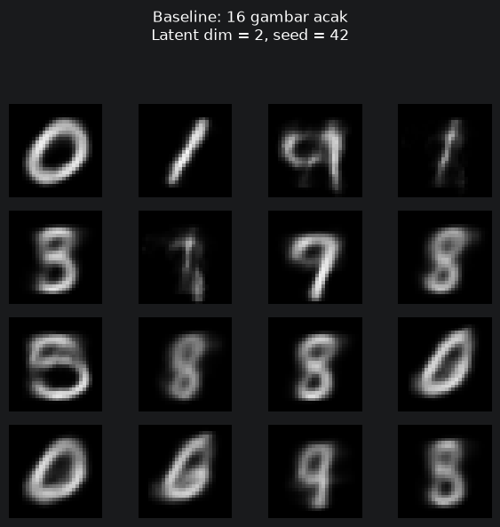
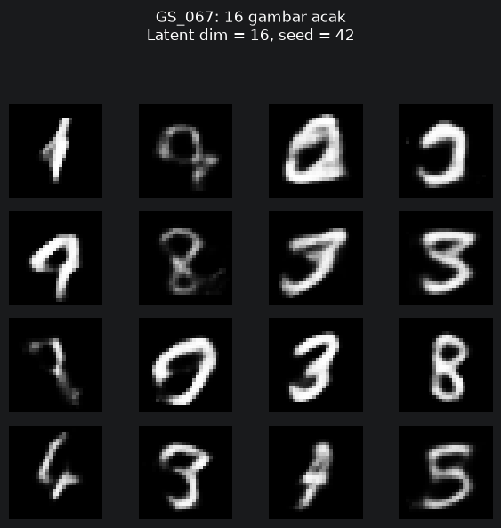
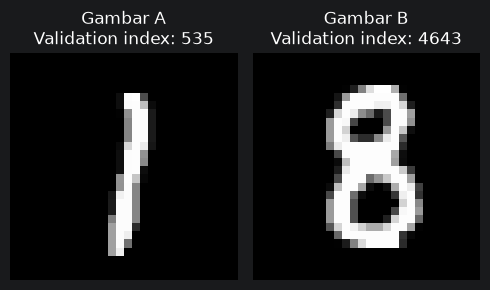
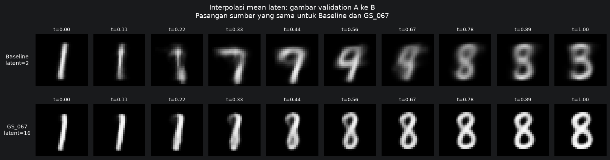

# GenAI-VAE — Generasi Angka Tulisan Tangan MNIST

> **Vibe Coding Generative AI from Scratch** · **Variational Autoencoder (VAE)** · **PyTorch** · **MNIST**  
> Proyek kelompok **Telertubbies** — Telkom University

Proyek ini mengimplementasikan **Variational Autoencoder (VAE) berbasis Multi-Layer Perceptron (MLP)** untuk mempelajari pola angka tulisan tangan pada dataset **MNIST**. Model digunakan untuk **merekonstruksi gambar**, **menghasilkan digit baru dari vektor laten acak**, dan **melakukan interpolasi** di antara representasi laten dua gambar.

Implementasi utama terdapat pada [`main.ipynb`](main.ipynb). Alur eksperimen mencakup persiapan data, pembuatan arsitektur dan fungsi *loss*, pelatihan *baseline*, *hyperparameter tuning*, pelatihan ulang lima konfigurasi teratas, pemilihan checkpoint terbaik, analisis, dan visualisasi. Interaksi selama pengembangan berbantuan LLM didokumentasikan secara terpisah.

## Anggota

- **A1:** Darel Ajni Fahrezi (NIM: 103012580009) — Ketua, Prompt Engineer & Arsitektur
- **A2:** Dianne Dini Al-Haq (NIM: 103012580032) — Training Loop & Hyperparameter Tuning Engineer
- **A3:** Debby Lelyca Rohdearni Damanik (NIM: 103012580001) — Loss & Optimization Engineer
- **A4:** Yasser Abdulah Ramadhan (NIM: 103012580039) — QA, Documentation & Error Handler

## Daftar Isi

- [Fitur Proyek](#fitur-proyek)
- [Dataset dan Data Pipeline](#dataset-dan-data-pipeline)
- [Arsitektur dan Loss VAE](#arsitektur-dan-loss-vae)
- [Eksperimen dan Hasil](#eksperimen-dan-hasil)
- [Visualisasi Hasil](#visualisasi-hasil)
- [Struktur Proyek](#struktur-proyek)
- [Instalasi dan Menjalankan Proyek](#instalasi-dan-menjalankan-proyek)
- [Penggunaan Checkpoint Tersimpan](#penggunaan-checkpoint-tersimpan)
- [Verifikasi, Reproduksibilitas, dan Batasan](#verifikasi-reproduksibilitas-dan-batasan)

## Fitur Proyek

- Pemrosesan dataset MNIST menjadi **training/validation/test**, menggunakan PyTorch `Dataset` dan `DataLoader`.
- Implementasi **VAE dari awal** dengan encoder MLP, `mu`, `logvar`, *reparameterization trick*, dan decoder MLP.
- Fungsi objektif **BCE + β × KL Divergence** beserta metrik per gambar.
- Pelatihan *baseline* dan *validation* dengan pencatatan metrik per epoch.
- **Grid Search 72 kombinasi**, masing-masing 10 epoch, dengan checkpoint dan ringkasan eksperimen.
- **Retraining lima konfigurasi terbaik** hingga 50 epoch dengan *early stopping patience* 5.
- **Pemuatan ulang checkpoint** untuk menghindari training yang tidak diperlukan.
- Analisis metrik, kode evaluasi *test set*, generasi 16 digit acak per model, dan interpolasi 10 titik dari dua gambar validasi.

## Dataset dan Data Pipeline

Dataset yang dipakai adalah **MNIST**, berisi citra grayscale berukuran **28 × 28 piksel**. Notebook membaca `data/mnist.npz` dengan empat array: `x_train`, `y_train`, `x_test`, dan `y_test`.

| Subset | Jumlah gambar | Penggunaan |
|---|---:|---|
| Training | 54.000 | Pembaruan bobot model |
| Validation | 6.000 | Evaluasi tiap epoch dan pemilihan konfigurasi/checkpoint |
| Test | 10.000 | Evaluasi akhir yang dipisahkan dari tuning |

Sebanyak 60.000 data training resmi dibagi 90:10 dengan **seed 42**. Data test resmi tetap terpisah. Piksel dinormalisasi dari `0–255` ke `0–1` (`float32`), kemudian diubah dari format NumPy `(N, 28, 28, 1)` menjadi tensor PyTorch `[B, 1, 28, 28]`.

`DataLoader` awal menggunakan **batch size 128**, dengan `shuffle=True` pada training serta `shuffle=False` pada validation dan test. Batch terakhir tetap digunakan (`drop_last=False`).

## Arsitektur dan Loss VAE

Arsitektur VAE di notebook menggunakan **MLP, bukan CNN**:

```text
Input MNIST [B, 1, 28, 28]
        │ flatten → [B, 784]
        ▼
Linear(784, hidden_dim) + ReLU
        │
        ├── Linear(hidden_dim, latent_dim) → mu
        └── Linear(hidden_dim, latent_dim) → logvar
                           │
           z = mu + exp(0.5 × logvar) × epsilon
                epsilon ~ N(0, I)
                           │
                           ▼
          Linear(latent_dim, hidden_dim) + ReLU
                           │
          Linear(hidden_dim, 784) + Sigmoid
                           │ reshape
                           ▼
          Rekonstruksi [B, 1, 28, 28]
```

Fungsi objektif:

$$
\mathcal{L}_{\mathrm{VAE}} = \mathrm{BCE} + \beta\,D_{\mathrm{KL}}
$$

BCE mengukur kesalahan rekonstruksi piksel, sedangkan KL Divergence meregularisasi distribusi laten agar mendekati normal standar. Dalam eksperimen ini **β = 1,0**. *Loss* dijumlahkan per gambar dan dirata-ratakan berdasarkan jumlah gambar (termasuk batch terakhir yang tidak penuh).

## Eksperimen dan Hasil

### 1. Baseline

| Konfigurasi | Nilai |
|---|---:|
| `hidden_dim` | 128 |
| `latent_dim` | 2 |
| `batch_size` | 128 |
| `learning_rate` | 0.001 |
| `beta` | 1.0 |
| Optimizer | Adam |
| Jumlah epoch pada versi terbaru | **50** |
| Parameter yang dapat dilatih | **202.516** |

Output riwayat dalam `main.ipynb` mencatat *validation loss* pada **epoch 50 sebesar 154,2543**. Nilai validasi paling rendah pada riwayat tersebut terjadi pada **epoch 49 (sekitar 154,2487)**, tetapi checkpoint baseline yang digunakan merupakan bobot epoch 50.

> **Perubahan dari README sebelumnya:** README lama menyebut baseline 10 epoch. Kode `main.ipynb` yang diperiksa sekarang menjalankan **50 epoch** jika checkpoint baseline belum tersedia.

### 2. Hyperparameter Tuning (Grid Search)

Cell 20–21 memakai ruang pencarian berikut:

| Hyperparameter | Nilai kandidat |
|---|---|
| `hidden_dim` | 128, 256, 512 |
| `latent_dim` | 2, 4, 8, 16 |
| `batch_size` | 64, 128 |
| `learning_rate` | 0.001, 0.005, 0.0001 |

Jumlah konfigurasi: **3 × 4 × 2 × 3 = 72 kombinasi**, masing-masing **10 epoch** dengan `seed=42` dan `beta=1.0`.

Output tersimpan Cell 21 mencatat **72 kombinasi berstatus `completed`**. Konfigurasi terbaik pada tahap Grid Search adalah **GS_067**, dengan *validation loss* **106,333612** pada epoch 10.

### 3. Retraining Top 5

Lima konfigurasi teratas dipilih dari hasil Grid Search, kemudian dilatih ulang dari bobot awal dengan maksimum **50 epoch** dan **early stopping patience 5**. Model pemenang dipilih berdasarkan *validation loss* minimum.

| Peringkat | Konfigurasi | Best validation loss | Epoch checkpoint terbaik | Epoch yang dijalankan |
|---:|---|---:|---:|---:|
| 1 | **GS_067** | **101,941903** | **50** | 50 |
| 2 | GS_070 | 102,282318 | 50 | 50 |
| 3 | GS_043 | 104,197562 | 46 | 50 |
| 4 | GS_071 | 105,151740 | 31 | 36 |
| 5 | GS_047 | 106,136819 | 37 | 42 |

Model terpilih **GS_067** memiliki konfigurasi:

```json
{
  "hidden_dim": 512,
  "latent_dim": 16,
  "batch_size": 64,
  "learning_rate": 0.001,
  "beta": 1.0,
  "seed": 42,
  "epochs": 50,
  "early_stopping_patience": 5,
  "source_config_id": "GS_067",
  "best_val_epoch": 50
}
```

*Validation loss* GS_067 setelah retraining (**101,941903**) sekitar **33,9% lebih rendah** dibanding *validation loss* baseline epoch 50 (**154,2543**). Perbandingan ini melibatkan lebih dari satu *hyperparameter* yang berbeda; hasilnya tidak dapat dikaitkan hanya dengan perubahan dimensi laten.

> **Status bukti:** Tabel di atas berasal dari **output eksekusi yang tersimpan** pada Cell 18, 21, 23, dan 24. Analisis serta kode evaluasi test set tersedia di Cell 27–49, tetapi bagian kode tersebut **tidak memiliki output eksekusi tersimpan** pada file notebook yang diperiksa. Karena itu, nilai test set yang hanya disebut dalam narasi Markdown notebook belum ditampilkan sebagai hasil terverifikasi pada README ini.

## Visualisasi Hasil

Gambar di bawah berasal dari **output gambar asli Cell 51–52 pada `main.ipynb`**. Agar terlihat di GitHub, file `.png` harus ditempatkan pada path relatif yang tertera di bawah, bersama dengan `README.md`.

### Generasi 16 digit acak

Setiap model menghasilkan **16 gambar** dalam grid 4 × 4, menggunakan sampel laten dari distribusi `Normal(0,1)` dengan **seed 42**.

**Baseline — `latent_dim=2`**



**GS_067 — `latent_dim=16`**



### Interpolasi di ruang laten

Sepasang gambar dari dataset validation dipakai sebagai sumber untuk **kedua model**. Mean laten hasil encoder (`mu_A` dan `mu_B`) diinterpolasikan dengan rumus:

$$
z(t) = (1-t)\,\mu_A + t\,\mu_B
$$

Interpolasi menggunakan **10 titik**, termasuk kedua ujung (`t=0` dan `t=1`). Pada output tersimpan, indeks validation yang dipilih adalah **535 dan 4643**, memperlihatkan perubahan bentuk digit yang menyerupai **1 menuju 8**.

**Pasangan gambar sumber**



**Perbandingan interpolasi Baseline dan GS_067**



Pengamatan visual pada contoh ini menunjukkan hasil GS_067 relatif lebih jelas pada beberapa tahap transisi. Ini adalah **pengamatan kualitatif terhadap satu pasangan gambar**, bukan bukti keunggulan universal model untuk setiap digit.

## Struktur Proyek

Struktur berikut merangkum **path yang digunakan oleh notebook** serta file dokumentasi dan aset yang disarankan. Beberapa folder hasil dibuat ketika cell terkait dijalankan. Struktur ini **bukan klaim bahwa seluruh folder telah tersedia dalam file yang diunggah ke chat**.

```text
GenAI-VAE/
├── main.ipynb
├── README.md
├── requirements.txt                  # Jika tersedia di repository Anda
├── data/
│   └── mnist.npz
├── docs/
│   ├── assets/
│   │   ├── generasi-baseline.png
│   │   ├── generasi-gs067.png
│   │   ├── pasangan-validasi.png
│   │   └── interpolasi-baseline-vs-gs067.png
│   └── ...                           # Dokumentasi / log interaksi LLM, bila ada
├── tests/                             # Opsional, bila tersedia dalam repository
└── results/
    ├── baseline/
    │   ├── vae_baseline.pth
    │   ├── vae_baseline_config.json
    │   ├── vae_baseline_history.json
    │   └── vae_baseline_results.csv
    ├── grid_search/
    │   ├── grid_config.json
    │   ├── grid_search_summary.csv
    │   ├── best_combination.json
    │   ├── top5_combinations.csv
    │   └── GS_001/ ... GS_072/       # Checkpoint dan metrik per kombinasi
    ├── retrain_top5/
    │   ├── retrain_summary.csv
    │   ├── comparison.csv
    │   └── GS_*/                      # Checkpoint, config, history
    ├── best_model/
    │   ├── best_model.pth
    │   ├── config.json
    │   └── comparison.csv
    ├── figures/                       # Hasil gambar/grafik .png
    └── evaluation/                    # CSV analisis dan evaluasi, bila dijalankan
```

## Instalasi dan Menjalankan Proyek

### Persyaratan

- Python 3, Jupyter Notebook atau VS Code dengan ekstensi Jupyter.
- Pustaka yang diimpor di notebook antara lain **PyTorch**, **NumPy**, **pandas**, dan **Matplotlib**.
- **GPU CUDA opsional**. Notebook memilih CUDA jika tersedia, dan CPU jika tidak.

Jika repository Anda sudah mempunyai `requirements.txt`, instal dependensi dari file tersebut:

```bash
python -m pip install -r requirements.txt
```

Apabila belum tersedia, contoh instalasi paket utama adalah:

```bash
python -m pip install torch numpy pandas matplotlib jupyter
```

Untuk varian PyTorch dengan CUDA, gunakan petunjuk instalasi dari [PyTorch](https://pytorch.org/get-started/locally/).

### Menjalankan notebook

1. Siapkan **`data/mnist.npz`** dengan key `x_train`, `y_train`, `x_test`, `y_test`. Notebook memeriksa ukuran array mentah: training `(60000, 28, 28)` dan testing `(10000, 28, 28)`.
2. Buka terminal pada **root project** agar path relatif `data/` dan `results/` sesuai.
3. Jalankan `jupyter notebook main.ipynb` atau buka `main.ipynb` dari VS Code.
4. Gunakan kernel Python dengan dependensi yang sesuai. Jalankan cell berurutan, dan baca bagian **Penggunaan Checkpoint Tersimpan** sebelum memilih **Run All**.

## Penggunaan Checkpoint Tersimpan

README lama proyek menekankan bahwa *baseline* dan Grid Search tidak perlu diulang apabila artefaknya sudah tersedia. Mekanisme tersebut juga terlihat pada notebook terbaru:

| Bagian notebook | Jika artefak tersedia | Jika belum tersedia |
|---|---|---|
| Cell 17–19: baseline | Pengujian satu epoch/training baseline dilewati; model dan riwayat dimuat; file baseline tidak ditimpa | Training baseline **50 epoch**, lalu hasil disimpan |
| Cell 20–21: Grid Search | Jika checkpoint model terbaik yang ditunjuk metadata tersedia, tuning dilewati; metadata dapat diambil dari `best_combination.json` atau dirunut dari CSV ringkasan | Tuning dijalankan; kombinasi yang sudah lengkap dan masih memiliki checkpoint dapat dilewati |
| Cell 23–24: retraining Top 5 | Jika `results/best_model/best_model.pth` ada, model dan metadata dimuat; hasil akhir tidak ditimpa | Top 5 dilatih ulang dan model terbaik disimpan |
| Cell 50–52: visualisasi | Memuat checkpoint baseline dan model terbaik untuk membuat gambar | Berhenti dengan error jika checkpoint wajib tidak ditemukan |

**Catatan:** Keberadaan satu checkpoint hasil Grid Search dapat membuat notebook melewati seluruh tahap tuning. Jika ingin **mengulang eksperimen dari awal**, cadangkan artefak terkait terlebih dahulu dan pastikan konfigurasi serta file hasil lama tidak tercampur dengan eksperimen baru. Training Grid Search 72 kombinasi dan retraining Top 5 dapat membutuhkan waktu komputasi yang besar.

## Verifikasi, Reproduksibilitas, dan Batasan

- **Pemeriksaan model dan data:** notebook berisi pengecekan bentuk tensor, rentang piksel, jumlah parameter, konsistensi loss, dan keberadaan checkpoint.
- **Reproduksibilitas:** pemisahan data, Grid Search, retraining, dan visualisasi menggunakan seed yang ditetapkan pada masing-masing cell (umumnya 42). Hasil dapat sedikit berbeda pada lingkungan/perangkat lain.
- **Evaluasi:** pemilihan model menggunakan **validation loss**, bukan data test. Kode evaluasi test set tersedia, tetapi output numeriknya belum tersimpan pada file notebook yang diperiksa.
- **Pengujian otomatis:** README lama menyediakan perintah berikut. Gunakan **hanya jika folder `tests/` memang ada** dalam repository Anda; folder ini tidak disertakan dalam unggahan yang saya periksa.

  ```bash
  python -m unittest discover -s tests -v
  ```

- **Aset README:** gambar memakai path relatif `docs/assets/`. Preview `README.md` yang dibuka tanpa folder tersebut dapat menampilkan ikon gambar rusak; setelah README dan keempat gambar berada pada struktur yang sama di GitHub, tautan gambar dapat ter-render.
- **Perubahan eksperimen:** dokumentasi prompting awal mencatat Grid Search 54 kombinasi dan baseline 10 epoch, sedangkan notebook terbaru memakai **72 kombinasi** dan **baseline 50 epoch**. README ini mengikuti versi notebook terbaru, bukan menganggap kedua eksperimen itu identik.