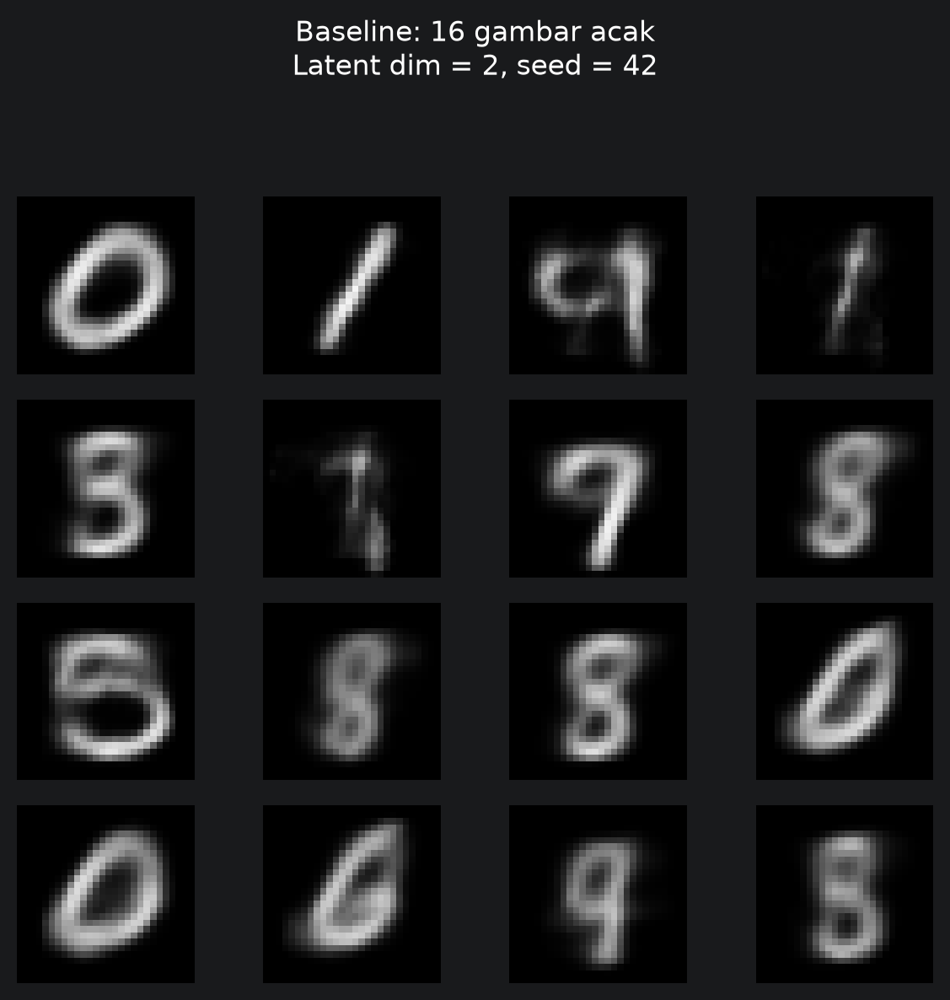
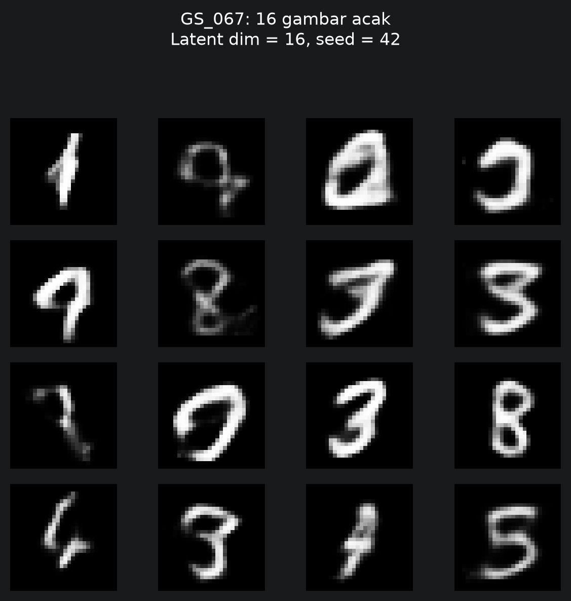
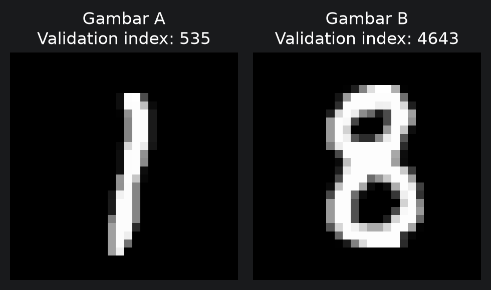
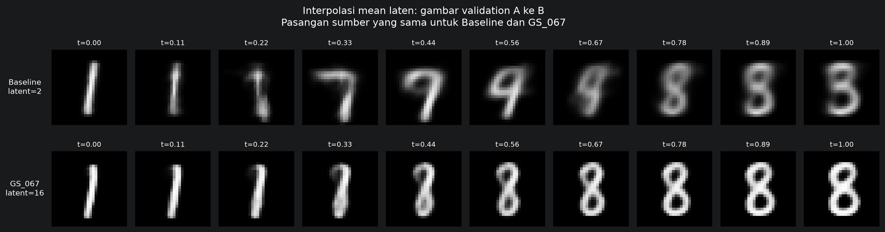

# Laporan Proyek Generative AI — Variational Autoencoder pada MNIST

**Kelompok Telertubbies**  
**Program Studi Informatika, Telkom University**  
**Periode pengerjaan:** Oktober 2026  
**Topik:** *Vibe Coding Generative AI from Scratch*  
**Repositori proyek:** [Proyek1-GenAI-VAE-Telertubbies](https://github.com/AI-IF-TelU/Proyek1-GenAI-VAE-Telertubbies)

> **Ringkasan:** Kelompok kami membangun model *Variational Autoencoder* (VAE) untuk mempelajari angka tulisan tangan dari dataset MNIST. Model tidak hanya mencoba menggambar ulang angka yang pernah dilihat, tetapi juga menghasilkan gambar digit baru dari masukan acak dan memperlihatkan perubahan bentuk secara bertahap di antara dua gambar. Pengembangan dilakukan dengan PyTorch, percobaan beberapa konfigurasi model, evaluasi hasil, kolaborasi Git, dan pendokumentasian penggunaan *large language model* (LLM).

## Daftar Isi

1. [Latar belakang dan tujuan](#1-latar-belakang-dan-tujuan)
2. [Gambaran metode](#2-gambaran-metode)
3. [Dataset dan persiapan data](#3-dataset-dan-persiapan-data)
4. [Model dan implementasi](#4-model-dan-implementasi)
5. [Tahapan eksperimen dan pemilihan model](#5-tahapan-eksperimen-dan-pemilihan-model)
6. [Hasil dan evaluasi](#6-hasil-dan-evaluasi)
7. [Rekonstruksi, generasi, dan interpolasi](#7-rekonstruksi-generasi-dan-interpolasi)
8. [Pemanfaatan AI dan dokumentasi prompting](#8-pemanfaatan-ai-dan-dokumentasi-prompting)
9. [Manajemen proyek dan pembagian peran](#9-manajemen-proyek-dan-pembagian-peran)
10. [Keterlacakan kontribusi melalui Git](#10-keterlacakan-kontribusi-melalui-git)
11. [Kendala, pembelajaran, dan keterbatasan](#11-kendala-pembelajaran-dan-keterbatasan)
12. [Kesimpulan dan pengembangan selanjutnya](#12-kesimpulan-dan-pengembangan-selanjutnya)
13. [Berkas pendukung dan sumber laporan](#13-berkas-pendukung-dan-sumber-laporan)

---

## 1. Latar Belakang dan Tujuan

Sebagian besar contoh penggunaan kecerdasan buatan berfokus pada **mengenali** informasi, seperti menentukan apakah suatu gambar berisi angka 3 atau 8. Proyek ini mengangkat persoalan yang berbeda: **bagaimana mesin mempelajari pola gambar angka tulisan tangan, kemudian menggunakan pola tersebut untuk membuat gambar baru?**

Kami memilih *Variational Autoencoder* (VAE), yaitu model generatif yang mempelajari representasi ringkas suatu gambar. Representasi ini memungkinkan model untuk merekonstruksi gambar masukan, membuat variasi gambar baru, dan menunjukkan transisi bentuk di antara dua contoh angka.

Tujuan proyek ini adalah:

- Membangun VAE sederhana dari awal menggunakan PyTorch, bukan menggunakan model generatif siap pakai.
- Menyiapkan data MNIST secara konsisten untuk pelatihan, pemilihan model, dan pengujian akhir.
- Membandingkan konfigurasi awal (*baseline*) dengan model hasil pencarian konfigurasi (*hyperparameter tuning*).
- Mengukur kualitas rekonstruksi secara numerik dan mengamati hasilnya secara visual.
- Menghasilkan angka baru dari representasi acak serta memvisualisasikan interpolasi antargambar.
- Mempraktikkan kerja tim menggunakan Git dan bantuan LLM, disertai log prompting, alasan penggunaan, dan hasil verifikasinya.

Proyek ini bersifat **eksperimen pembelajaran model generatif**, bukan aplikasi pengenalan angka, layanan komersial, atau sistem dengan antarmuka pengguna akhir.

## 2. Gambaran Metode

Metode yang digunakan dapat diringkas menjadi alur berikut:

**Data MNIST → persiapan data → VAE awal → pelatihan → pencarian konfigurasi → pelatihan ulang kandidat terbaik → evaluasi → generasi dan interpolasi gambar.**

VAE mempunyai dua bagian utama:

1. **Encoder** mempelajari cara merangkum gambar ke suatu ruang representasi yang lebih kecil (*latent space*).
2. **Decoder** mempelajari cara menyusun kembali representasi tersebut menjadi gambar berukuran 28 × 28 piksel.

Berbeda dari *autoencoder* biasa, VAE mempelajari **distribusi** representasi, bukan hanya satu kode tetap untuk tiap gambar. Hal ini memungkinkan pengambilan contoh acak dari ruang representasi tersebut untuk menghasilkan angka baru.

### Cara menilai pembelajaran model

Kami menggunakan dua komponen kesalahan (*loss*):

| Komponen | Penjelasan sederhana |
|---|---|
| **Binary Cross-Entropy (BCE)** | Menggambarkan seberapa jauh nilai piksel hasil rekonstruksi dari gambar asli. |
| **KL Divergence (KL)** | Membantu menata ruang representasi agar distribusinya mendekati distribusi normal standar. |

Keduanya digabung sebagai **total loss = BCE + β × KL**, dengan **β = 1** pada eksperimen ini. Nilai yang lebih rendah menunjukkan hasil yang lebih baik **berdasarkan fungsi penilaian tersebut**, tetapi tetap perlu dilihat bersama contoh gambar karena metrik numerik tidak sepenuhnya mewakili kualitas visual.

## 3. Dataset dan Persiapan Data

### 3.1 Dataset

Proyek menggunakan **MNIST**, kumpulan gambar angka tulisan tangan 0–9 dalam bentuk **grayscale 28 × 28 piksel**. Dataset dibaca dari `data/mnist.npz` dan memiliki pembagian resmi 60.000 gambar latih serta 10.000 gambar test.

Bagian latih resmi dibagi kembali menggunakan proporsi **90:10** dengan *random seed* **42**, sedangkan data test resmi tetap terpisah.

| Bagian data | Jumlah gambar | Tujuan |
|---|---:|---|
| **Training** | 54.000 | Model mempelajari pola dan memperbarui bobot. |
| **Validation** | 6.000 | Memantau pelatihan dan memilih konfigurasi terbaik. |
| **Test** | 10.000 | Menilai kinerja akhir setelah proses pemilihan model. |
| **Total** | **70.000** | Seluruh data MNIST yang digunakan. |

Pembagian ini penting agar hasil pengujian akhir tidak digunakan untuk menentukan konfigurasi model.

### 3.2 Tahapan persiapan

- **Normalisasi:** nilai piksel dari 0–255 diubah menjadi 0–1 agar sesuai dengan keluaran decoder dan perhitungan BCE.
- **Penyesuaian bentuk:** gambar disiapkan dengan satu kanal grayscale untuk dapat dibaca oleh PyTorch.
- **Pembentukan batch:** kumpulan gambar dibaca bertahap oleh `DataLoader` agar pelatihan lebih teratur.
- **Pengacakan terbatas:** urutan gambar training diacak, sedangkan validation dan test tidak diacak agar pembacaan hasil konsisten.
- **Pemeriksaan awal:** jumlah data, bentuk tensor, tipe data, rentang piksel, dan jumlah batch diverifikasi sebelum masuk ke model.

Dengan *batch size* awal **128**, terdapat **422 batch training**, **47 batch validation**, dan **79 batch test**. Batch terakhir yang tidak penuh tetap digunakan, sehingga data tidak dibuang.

## 4. Model dan Implementasi

### 4.1 Arsitektur model

Model dibuat menggunakan **Multi-Layer Perceptron (MLP)**, yaitu jaringan saraf dengan lapisan terhubung penuh. MLP dipilih karena relatif mudah dipahami dan diimplementasikan untuk gambar MNIST berukuran kecil.

Alur sederhananya:

**Gambar 28 × 28 → Encoder → Ruang laten → Decoder → Gambar rekonstruksi 28 × 28.**

Encoder menghasilkan dua informasi, yaitu nilai rata-rata (`mu`) dan penyebaran distribusi (`logvar`). Selanjutnya, model mengambil representasi laten melalui proses *reparameterization*. Decoder mengubahnya kembali menjadi gambar. Keluaran piksel dibatasi ke rentang 0–1.

Berikut dua konfigurasi yang dibandingkan pada laporan ini:

| Aspek | Baseline | Model terbaik **GS_067** |
|---|---:|---:|
| Ukuran lapisan tersembunyi | 128 | 512 |
| Dimensi ruang laten | 2 | 16 |
| Batch size | 128 | 64 |
| Learning rate | 0,001 | 0,001 |
| Jumlah parameter model | 202.516 | 829.232 |
| Optimizer | Adam | Adam |

Konfigurasi GS_067 lebih besar dibanding baseline. Hal ini memberi ruang representasi yang lebih kaya, dengan konsekuensi kebutuhan komputasi yang lebih tinggi.

### 4.2 Bentuk implementasi

Implementasi utama tersedia di [`main.ipynb`](../main.ipynb). Notebook menggabungkan persiapan data, model VAE, fungsi loss, pelatihan, pencarian konfigurasi, penyimpanan hasil, evaluasi, dan visualisasi.

Beberapa keputusan implementasi yang penting untuk pengelolaan proyek:

- **Pencatatan hasil:** nilai loss selama pelatihan, konfigurasi percobaan, dan checkpoint model disimpan agar dapat dibandingkan kembali.
- **Penggunaan model tersimpan:** ketika checkpoint sudah tersedia, proses pelatihan tertentu dapat dilewati sehingga tidak mengulang komputasi yang panjang.
- **Pemisahan data:** data validation digunakan selama pemilihan model, sedangkan test digunakan pada penilaian akhir.
- **Pengujian bertahap:** setiap komponen diperiksa sebelum melanjutkan ke tahap berikutnya, misalnya bentuk tensor, komponen loss, dan kemampuan memuat checkpoint.
- **Reproduksibilitas:** seed tetap digunakan dalam pembagian data, eksperimen, serta beberapa tahap evaluasi dan visualisasi.

## 5. Tahapan Eksperimen dan Pemilihan Model

Pencarian model dilakukan secara bertahap, bukan langsung memilih arsitektur terbesar.

### Tahap 1 — Pelatihan baseline

Model dengan dimensi tersembunyi 128 dan dimensi laten 2 dilatih selama **50 epoch**. Baseline menjadi titik pembanding untuk mengukur manfaat pencarian konfigurasi. *Validation loss* tercatat menurun dari sekitar **182,97** pada epoch pertama menjadi **154,25** pada epoch ke-50.

### Tahap 2 — Grid Search

*Grid Search* adalah metode mencoba seluruh kombinasi dari beberapa pilihan pengaturan model. Empat pengaturan yang dibandingkan adalah:

| Pengaturan | Nilai yang dicoba | Arti secara singkat |
|---|---|---|
| **Hidden dimension** | 128, 256, 512 | Kapasitas lapisan yang mempelajari pola gambar. |
| **Latent dimension** | 2, 4, 8, 16 | Besar ruang representasi ringkas. |
| **Batch size** | 64, 128 | Jumlah gambar yang diproses sekaligus. |
| **Learning rate** | 0,0001; 0,001; 0,005 | Besarnya langkah pembaruan bobot. |

Sebanyak **72 kombinasi** (3 × 4 × 2 × 3) dijalankan masing-masing hingga **10 epoch**. Hasil percobaan dicatat, kemudian diurutkan berdasarkan *validation loss* terendah. Ringkasan proyek mencatat **seluruh 72 kombinasi selesai**.

Pada **64 dari 72 konfigurasi**, nilai validasi terbaik masih terjadi pada epoch terakhir (epoch 10). Temuan ini menjadi alasan praktis untuk melatih kandidat terbaik lebih lama.

### Tahap 3 — Pelatihan ulang lima kandidat terbaik

Lima konfigurasi terbaik dari Grid Search kemudian **dilatih ulang dari bobot awal**, hingga maksimal **50 epoch**. Untuk menghindari pelatihan yang tidak perlu, digunakan *early stopping* dengan toleransi **5 epoch berturut-turut** tanpa perbaikan *validation loss*.

| Peringkat setelah pelatihan ulang | ID model | Best validation loss | Epoch terbaik |
|---:|---|---:|---:|
| 1 | **GS_067** | **101,9419** | 50 |
| 2 | GS_070 | 102,2823 | 50 |
| 3 | GS_043 | 104,1976 | 46 |
| 4 | GS_071 | 105,1517 | 31 |
| 5 | GS_047 | 106,1368 | 37 |

Model **GS_067** dipilih karena memperoleh *validation loss* paling rendah setelah pelatihan ulang. Checkpoint final beserta konfigurasi dan ringkasan perbandingannya disimpan di folder `results/best_model/`.

**Catatan pemilihan:** GS_067 berbeda dari baseline pada beberapa pengaturan sekaligus. Karena itu, peningkatan hasil tidak dapat dikaitkan hanya dengan satu variabel tanpa melihat analisis perbandingan terkontrol.

## 6. Hasil dan Evaluasi

### 6.1 Hasil pada data validasi

| Model | Validation loss akhir/terpilih |
|---|---:|
| Baseline (epoch 50) | **154,25** |
| GS_067 (checkpoint terbaik epoch 50) | **101,94** |

Dibanding baseline, *validation loss* model terbaik sekitar **33,9% lebih rendah**. Perbedaan ini menunjukkan bahwa konfigurasi yang dipilih melalui pencarian dan pelatihan ulang menghasilkan rekonstruksi serta pengaturan ruang laten yang lebih baik menurut fungsi loss proyek.

### 6.2 Evaluasi akhir pada data test

Presentasi kelompok dan narasi analisis di notebook melaporkan evaluasi pada **10.000 gambar test** sebagai berikut:

| Model | BCE per gambar | KL per gambar | Total loss per gambar | Validation loss |
|---|---:|---:|---:|---:|
| **Baseline** | 148,46 | 6,02 | **154,48** | 154,25 |
| **GS_067** | 78,15 | 23,38 | **101,53** | 101,94 |

**Hasil utama:** Total loss GS_067 pada test set **sekitar 34,3% lebih rendah** dibanding baseline. Perbaikan terutama berasal dari penurunan kesalahan rekonstruksi (BCE), meskipun komponen KL meningkat. Ini menunjukkan adanya pertukaran antara ketelitian rekonstruksi dan keteraturan ruang laten.

Nilai *test loss* juga relatif dekat dengan *validation loss* masing-masing model. Hal tersebut mendukung bahwa kinerja model tidak berubah drastis pada data test yang terpisah, namun **tidak dengan sendirinya membuktikan model bebas dari overfitting**.

> **Status verifikasi hasil test:** Nilai dalam tabel di atas **tercantum dalam slide presentasi dan analisis Markdown di `main.ipynb`**. Pada salinan notebook yang tersedia untuk penyusunan laporan, cell kode evaluasi test (sekitar Cell 40–48) **belum memiliki output eksekusi yang tersimpan**. Karena itu, tabel ini diperlakukan sebagai **hasil yang dilaporkan kelompok**, bukan hasil yang saya jalankan ulang atau audit dari file CSV test secara mandiri.

### 6.3 Apa yang paling berpengaruh?

Dari analisis perbandingan terkontrol yang ditampilkan pada presentasi:

- **Dimensi laten** menunjukkan dampak paling jelas: ketika ditingkatkan dari 2 menjadi 16 pada konfigurasi pembanding, *validation loss* turun dari sekitar **152,08** menjadi **106,33**.
- **Learning rate** sebesar **0,001** memberi hasil lebih baik pada perbandingan yang ditampilkan dibanding nilai **0,0001**, yang bergerak lebih lambat selama 10 epoch pengujian.
- Perubahan **hidden dimension** dan **batch size** juga berpengaruh, tetapi pada perbandingan yang ditampilkan selisihnya lebih kecil daripada perubahan dimensi laten.

Hasil ini berlaku untuk ruang pencarian, jumlah epoch, dan dataset pada proyek, bukan kesimpulan universal bahwa dimensi laten selalu menjadi faktor terpenting untuk semua VAE.

## 7. Rekonstruksi, Generasi, dan Interpolasi

Selain angka loss, kelompok mengevaluasi **apa yang benar-benar terlihat pada gambar**.

### 7.1 Rekonstruksi gambar

Rekonstruksi berarti model menerima sebuah digit, merangkumnya, lalu mencoba menggambar ulang digit tersebut. Perbandingan memakai contoh input yang sama untuk kedua model.

Secara visual, **GS_067 umumnya menghasilkan digit yang lebih tajam dan lebih mudah dikenali** dibanding baseline. Namun, sebagian gambar tulisan tangan dengan gaya tidak biasa tetap sulit direkonstruksi. Model dapat menghilangkan goresan tambahan atau mengubah bentuk menjadi versi digit yang lebih lazim.

Analisis kelompok menunjukkan bahwa delapan contoh rekonstruksi terbaik menurut GS_067 merupakan **digit 1** dengan goresan relatif sederhana. Sebaliknya, contoh dengan hasil paling sulit mencakup angka dengan goresan tebal, bentuk yang kurang umum, atau detail tambahan. Ini menunjukkan pentingnya membaca **nilai loss bersama gambar**, bukan hanya satu ukuran numerik.

Berkas visual yang direncanakan/dihasilkan oleh kode notebook mencakup:

- `results/figures/reconstruction_fixed_samples.png` — sepuluh angka sumber beserta rekonstruksi kedua model.
- `results/figures/reconstruction_worst_best_model.png` — delapan contoh rekonstruksi dengan BCE tertinggi menurut GS_067.
- `results/figures/reconstruction_best_best_model.png` — delapan contoh dengan BCE terendah.

### 7.2 Generasi gambar baru

Generasi berbeda dari rekonstruksi: **tidak diperlukan gambar sumber**. Model mengambil sebuah vektor acak dari distribusi normal lalu mengubahnya menjadi gambar angka. Pada proyek ini, setiap model menghasilkan **16 gambar baru** yang ditampilkan sebagai grid **4 × 4** menggunakan *seed* **42**.

Pengamatan kelompok menunjukkan karakter yang berbeda: baseline cenderung menghasilkan bentuk mirip digit tetapi lebih kabur, sedangkan GS_067 dapat menghasilkan gambar lebih tajam meskipun sebagian bentuk acaknya masih kurang wajar.

**Baseline (16 gambar):**

**Model GS_067 (16 gambar):**

### 7.3 Interpolasi ruang laten

Interpolasi dilakukan untuk melihat perubahan bertahap dari representasi satu gambar menuju gambar lainnya. Kelompok menggunakan **dua gambar validation yang sama pada kedua model**, lalu membuat **10 titik transisi** menggunakan rata-rata representasi encoder agar hasil dapat dibandingkan secara konsisten.

Pada contoh yang tersimpan dalam notebook, gambar sumber berada pada indeks validation **535** dan **4643** dan menghasilkan perubahan bentuk yang menyerupai **angka 1 menuju 8**.

- **Baseline (latent dimension 2):** transisi sempat membentuk digit lain, menyerupai urutan **1 → 7 → 9 → 8**.
- **GS_067 (latent dimension 16):** perubahan pada contoh ini terlihat lebih mulus menuju angka 8.

**Pasangan gambar sumber:**

**Perbandingan interpolasi:**

## 8. Pemanfaatan AI dan Dokumentasi Prompting

Proyek menggunakan pendekatan **vibe coding yang terarah**, yaitu LLM membantu menjelaskan konsep, menyusun potongan kode, memeriksa hasil, dan menyelesaikan error. Tim tetap bertanggung jawab untuk menguji kesesuaian kode, memastikan angka tidak dibuat-buat, dan memutuskan langkah eksperimen.

Alur interaksi yang digunakan:

**Merumuskan kebutuhan → membuat prompt spesifik → menerima kode/penjelasan → menjalankan kode → memeriksa output → memperbaiki error atau melanjutkan tahap berikutnya.**

### 8.1 Bentuk penggunaan LLM

| Tahap pekerjaan | Bentuk bantuan AI | Pemeriksaan oleh tim |
|---|---|---|
| Persiapan MNIST | Menyusun kode normalisasi, dataset, dan DataLoader. | Memeriksa jumlah gambar, bentuk input, nilai piksel, dan batch. |
| Arsitektur VAE | Menjelaskan encoder, decoder, ruang laten, dan fungsi loss. | Menguji bentuk keluaran dan jumlah parameter model. |
| Pelatihan | Membantu menyusun loop training serta validasi. | Mengecek perubahan loss dan penyimpanan hasil. |
| Tuning | Membantu mengelola kombinasi, ringkasan CSV, dan checkpoint. | Memeriksa jumlah kombinasi, peringkat, serta pemilihan model terbaik. |
| Evaluasi | Membantu perhitungan BCE, KL, pengujian test, dan visualisasi. | Membandingkan hasil numerik dengan gambar. |
| Debugging | Menganalisis traceback dan ketergantungan antar-cell. | Mencoba solusi tanpa mengulang training yang tidak perlu. |
| Dokumentasi | Membantu menjelaskan alasan prompting dan hasilnya. | Menyesuaikan uraian dengan kode serta output yang tercatat. |

Dalam riwayat kerja, tim menggunakan **ChatGPT** dan **DeepSeek** untuk tugas yang berbeda. Interaksi tidak berhenti pada satu jawaban: beberapa prompt memperbaiki hasil sebelumnya, antara lain kesalahan perhitungan parameter, masalah tipe data saat penyimpanan, variabel yang tidak tersedia ketika cell dijalankan terpisah, dan kebutuhan menghindari penimpaan checkpoint.

### 8.2 Akuntabilitas penggunaan AI

Untuk menjaga transparansi, dokumentasi log interaksi mencatat **tanggal dan tautan sesi**, **judul prompting**, **isi prompt**, **alasan khusus**, serta **output yang dihasilkan**. Jika terjadi error, dokumentasinya memisahkan **pesan error asli**, **permintaan perbaikan**, dan **analisis solusinya**.

LLM berfungsi sebagai **asisten pengembangan**, bukan pengganti uji coba atau penanggung jawab hasil penelitian. Keberhasilan teknis tetap ditentukan oleh eksekusi kode, validasi output, dan pemeriksaan bersama.

## 9. Manajemen Proyek dan Pembagian Peran

### 9.1 Pembagian tugas kelompok

Berikut pembagian tugas yang tercantum pada **slide 22 presentasi kelompok**:

| Anggota | Peran utama | Lingkup kontribusi yang direncanakan/dilaporkan |
|---|---|---|
| **Darel Ajni Fahrezi** | **Ketua & Arsitektur** | Perancangan arsitektur model dan fungsi loss, integrasi notebook, generasi gambar, serta interpolasi ruang laten. |
| **Debby Lelyca R Damanik** | **Data & Evaluasi** | Persiapan dan preprocessing data, analisis hasil pelatihan dan tuning, serta evaluasi model pada test set. |
| **Dianne Dini Al-haq** | **Training & Tuning** | Training loop, Grid Search, pelatihan ulang lima kandidat terbaik, pengelolaan checkpoint, dan pemilihan model terbaik. |
| **Yasser A Ramadhan** | **Dokumentasi** | Pencatatan log interaksi LLM, penyusunan laporan, dan rekapitulasi kontribusi tim. |

Pembagian ini menunjukkan bahwa pekerjaan dibagi berdasarkan **alur pengembangan model**, sehingga setiap anggota memiliki tanggung jawab yang jelas, tetapi tetap membutuhkan koordinasi. Misalnya, tahap evaluasi memerlukan checkpoint dari hasil training; visualisasi generasi memerlukan model dan data yang sudah disiapkan; sedangkan dokumentasi membutuhkan rekaman keputusan dan hasil dari seluruh tahap.

### 9.2 Cara kerja bersama

Berdasarkan alur kolaborasi yang dijelaskan dalam presentasi, tim menerapkan pendekatan berikut:

1. **Pemisahan pekerjaan melalui branch** sesuai fitur atau tugas anggota.
2. **Commit bertahap** untuk mencatat perkembangan, revisi, dan perbaikan.
3. **Pull request** sebagai media pengajuan perubahan dan pemeriksaan integrasi.
4. **Review dan merge** sebelum kode utama digunakan bersama.
5. **Penyimpanan artefak** seperti checkpoint dan grafik agar anggota lain tidak perlu mengulang pekerjaan komputasi.

Penggunaan checkpoint tersimpan menjadi bagian penting dari koordinasi: model yang telah selesai dilatih dapat dipakai ulang untuk analisis, evaluasi, dan visualisasi, tanpa menimpa hasil eksperimen terdahulu.

### 9.3 Alur kerja dan ketergantungan

| Tahap | Hasil kerja | Digunakan oleh tahap berikutnya |
|---|---|---|
| Persiapan data | Dataset dan DataLoader | Implementasi dan training VAE |
| Perancangan model | Arsitektur dan fungsi loss | Pelatihan baseline |
| Training dan tuning | Riwayat metrik, checkpoint, daftar kandidat | Evaluasi dan analisis |
| Evaluasi | Metrik test dan gambar rekonstruksi | Pembahasan hasil akhir |
| Generasi dan interpolasi | Contoh gambar dan analisis visual | Presentasi serta kesimpulan |
| Dokumentasi | Log prompting, laporan, riwayat keputusan | Bukti proses kerja seluruh anggota |

## 10. Keterlacakan Kontribusi melalui Git

Pembagian kerja di atas harus dapat **dicocokkan dengan jejak kontribusi**. Untuk itu, repositori dapat digunakan sebagai tempat menelusuri perubahan kode dari waktu ke waktu, bukan sekadar sebagai tempat menyimpan versi akhir.

- [Lihat repositori proyek](https://github.com/AI-IF-TelU/Proyek1-GenAI-VAE-Telertubbies)
- [Lihat riwayat commit](https://github.com/AI-IF-TelU/Proyek1-GenAI-VAE-Telertubbies/commits)
- [Lihat pull request](https://github.com/AI-IF-TelU/Proyek1-GenAI-VAE-Telertubbies/pulls)
- [Lihat ringkasan kontributor](https://github.com/AI-IF-TelU/Proyek1-GenAI-VAE-Telertubbies/graphs/contributors)

**Cara membaca bukti kontribusi:**

| Peran | Bukti yang perlu dicocokkan di Git |
|---|---|
| Ketua & arsitektur | Commit/PR terkait kelas VAE, fungsi loss, integrasi notebook, generasi, dan interpolasi. |
| Data & evaluasi | Commit/PR terkait preprocessing MNIST, DataLoader, analisis, metrik test, dan visualisasi evaluasi. |
| Training & tuning | Commit/PR terkait training loop, konfigurasi Grid Search, retraining, pemilihan model, dan checkpoint. |
| Dokumentasi | Commit/PR terkait log interaksi LLM, README, laporan Markdown, dan materi dokumentasi. |

> **Batas verifikasi riwayat Git:** Saat laporan ini disusun, halaman repositori dan commit history **belum berhasil diakses dari lingkungan pemeriksaan**. Karena itu, **nama penulis commit, hash, tanggal commit per anggota, jumlah commit, serta status PR belum dapat diverifikasi secara langsung**. Tabel peran bersumber dari **presentasi kelompok**, bukan hasil audit Git. Untuk memenuhi persyaratan bahwa pembagian peran tercermin dalam commit history, kelompok perlu mencocokkan tiap baris dengan commit/PR nyata dan, jika diperlukan, menambahkan tautan ke commit yang sesuai. Tidak ada hash atau statistik commit yang direka dalam laporan ini.

Untuk audit lebih lanjut, riwayat perubahan pada **seluruh branch** perlu ikut diperiksa. Satu pekerjaan bisa tersebar dalam beberapa commit, dan nama penulis Git tidak selalu otomatis cocok dengan nama anggota di dokumen. Selain itu, perubahan hasil integrasi bisa tercatat dalam commit gabungan. Dengan demikian, penilaian kontribusi sebaiknya mempertimbangkan **isi perubahan dan proses review**, bukan hanya banyaknya commit.

## 11. Kendala, Pembelajaran, dan Keterbatasan

### 11.1 Kendala pengembangan

Beberapa tantangan yang tercatat dalam riwayat pengembangan dan penjelasan kelompok adalah:

- **Ketergantungan antar-cell notebook:** suatu cell dapat gagal ketika variabel dari tahap sebelumnya belum tersedia dalam kernel yang baru.
- **Ketidaksesuaian variabel atau tipe data:** misalnya hasil disimpan sebagai daftar per-epoch tetapi diperlakukan sebagai satu angka.
- **Risiko menjalankan training ulang:** eksperimen puluhan konfigurasi memerlukan waktu dan dapat menimpa checkpoint jika tidak dilindungi pengecekan file.
- **Perubahan konfigurasi selama proyek:** rancangan awal dan versi akhir menggunakan jumlah epoch serta ruang pencarian yang berbeda, sehingga dokumentasi perlu mengikuti implementasi terakhir.
- **Kesenjangan metrik dan kualitas visual:** loss lebih kecil belum tentu menggambarkan seluruh karakter gambar yang dihasilkan, khususnya pada tulisan tangan yang tidak lazim.

Kendala tersebut mendorong tim untuk menambah validasi, memakai checkpoint, memperjelas penamaan berkas, dan memeriksa hasil sebelum melanjutkan tahapan berikutnya.

### 11.2 Keterbatasan model

- Arsitektur yang digunakan masih **MLP**, sehingga belum memanfaatkan struktur spasial gambar sebagaimana arsitektur konvolusional.
- Beberapa gambar baru dari sampel acak tampak **kurang wajar atau ambigu**.
- Rekonstruksi bisa menghilangkan goresan kecil atau mengubah bentuk tulisan tangan menjadi pola yang lebih umum.
- Kinerja yang dibandingkan terbatas pada **MNIST** serta pilihan konfigurasi dalam eksperimen ini.
- Model GS_067 masih menunjukkan perbaikan hingga epoch 50; karena itu belum dapat dipastikan bahwa pelatihan lebih lama tidak akan memberi hasil lebih baik.
- Hasil evaluasi bergantung pada prosedur sampling laten; pengujian beberapa seed membantu memperkirakan variasinya, tetapi bukan pengganti pengulangan training dari awal.

### 11.3 Hal yang dipelajari

Proyek menunjukkan bahwa pengembangan model generatif tidak cukup hanya membuat kode berjalan. Keputusan terkait pemisahan data, eksperimen yang adil, penyimpanan hasil, pemeriksaan error, dan evaluasi visual sama pentingnya dengan pembuatan arsitektur. Dokumentasi prompting dan Git juga membantu membedakan **kode yang diusulkan AI** dari **hasil yang telah diperiksa dan disepakati tim**.

## 12. Kesimpulan dan Pengembangan Selanjutnya

Kelompok Telertubbies berhasil membangun alur proyek **VAE berbasis MLP untuk MNIST**, dari persiapan data hingga generasi gambar dan interpolasi ruang laten. Pencarian **72 konfigurasi**, disusul pelatihan ulang **lima kandidat terbaik**, menghasilkan model **GS_067** sebagai model terpilih.

Dibandingkan baseline, GS_067 mencapai *validation loss* sekitar **33,9% lebih rendah**. Berdasarkan hasil test yang dilaporkan pada presentasi dan analisis notebook, total loss juga sekitar **34,3% lebih rendah**. Perbandingan gambar memperlihatkan peningkatan ketajaman rekonstruksi pada banyak contoh, tetapi tidak meniadakan kasus kegagalan pada tulisan tangan yang sulit.

Tiga arah pengembangan yang disarankan adalah:

1. **Menguji decoder konvolusional** untuk meningkatkan ketelitian detail gambar.
2. **Menguji nilai β yang berbeda** untuk memahami keseimbangan antara kesalahan rekonstruksi dan keteraturan ruang laten.
3. **Melatih kandidat terbaik lebih lama** dengan evaluasi yang tetap konsisten, mengingat GS_067 masih membaik pada akhir pelatihan yang tercatat.

Secara keseluruhan, nilai utama proyek bukan hanya checkpoint model terbaik, melainkan juga **proses eksperimen yang terstruktur, penggunaan AI yang diperiksa secara kritis, dan kerja sama antaranggota yang terdokumentasi**.

## 13. Berkas Pendukung dan Sumber Laporan

Laporan ini disusun berdasarkan berkas internal proyek yang diberikan kelompok:

| Sumber | Informasi yang digunakan |
|---|---|
| [`main.ipynb`](../main.ipynb) | Implementasi data pipeline, VAE, pelatihan, hasil checkpoint, evaluasi, generasi, dan interpolasi. |
| [`README.md`](../README.md) | Deskripsi repositori, struktur proyek, instruksi pelaksanaan, serta penggunaan checkpoint tersimpan. |
| Presentasi **“Variational Autoencoder pada Dataset MNIST”** | Tujuan, ringkasan hasil akhir, interpretasi grafik, pembagian tugas, penggunaan AI, serta alur kolaborasi Git. |
| Dokumentasi **Log Interaksi LLM** | Riwayat prompting, alasan pemakaian AI, output, koreksi, debugging, dan perkembangan modul. |
| Folder `results/` (apabila tersedia dalam repositori) | Checkpoint, konfigurasi, tabel eksperimen, dan gambar keluaran yang dirujuk notebook. |

**Cara menempatkan laporan di GitHub:** Simpan file ini sebagai **`report/LAPORAN_PROYEK.md`**. Berkas presentasi yang sudah dibuat dapat ditempatkan di folder `report/` yang sama. Tautan ke `../main.ipynb` dan `../README.md` akan berfungsi jika kedua berkas berada di root repositori. Tautan ke gambar hanya akan tampil bila file `results/figures/` terkait juga sudah masuk ke Git.

---

*Laporan ini mengutamakan narasi yang dapat dipahami pembaca umum. Angka eksperimen bersumber dari notebook dan presentasi; aktivitas Git yang belum diverifikasi secara langsung tidak diklaim sebagai bukti individual.*
